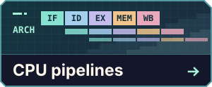

### Hey, I’m Lowmist 👋

I keep my computer science notes here, from red-black trees to the occasional detour into C++. These days I’m also building a project of my own. It’s still taking shape.

**From my notebook** · Three pages to explore, written in Chinese.

  
  
  

