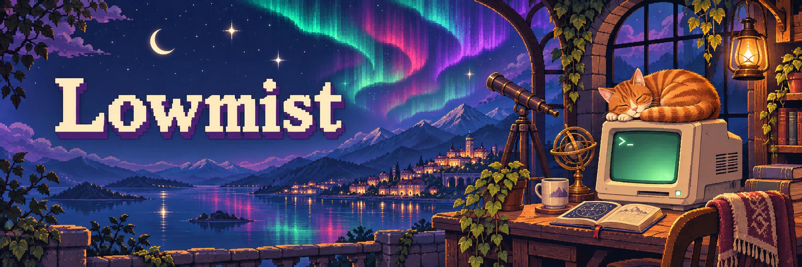
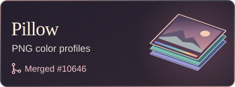

<picture>
  <source media="(prefers-color-scheme: light)" srcset="https://raw.githubusercontent.com/LowmistLMT/LowmistLMT/main/assets/alpenglow-observatory.webp">
  
</picture>

### Hey, I’m Lowmist 👋

When a training run crashes, I want to know what the logs showed just before it failed. I built **TrainLens** to find those clues and compare the run with the ones that finished.

<a href="https://github.com/LowmistLMT/trainlens">
  <picture>
    <source media="(max-width: 767px)" srcset="https://raw.githubusercontent.com/LowmistLMT/LowmistLMT/main/assets/trainlens-feature-compact.svg">
    
  </picture>
</a>

[Explore TrainLens](https://github.com/LowmistLMT/trainlens) · [Run the offline demo](https://github.com/LowmistLMT/trainlens#30-second-offline-quickstart)

Would you keep checkpoint 500 or 600?

For the baseline run in the demo, I’d keep **checkpoint 500**. Its validation loss was **1.12**. By step 600, training loss had fallen from 0.95 to 0.89, but validation loss had climbed to **1.15**.

### Open source contributions

I fixed how Pillow handles incomplete PNG color profiles and how GPT Researcher renders Markdown tables split across streamed updates.

  
  

